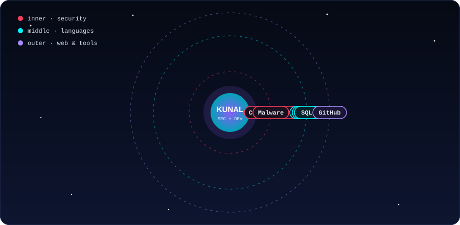
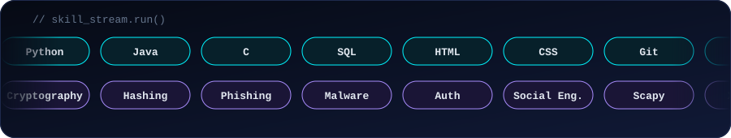

 

 

### 🛰️ My universe

I'm a B.Tech Cyber Security student at **Gurugram University** who likes breaking things to understand them, then building tools that protect them. Below is everything I work with, orbiting around the one thing that connects it all: security and code.

### 🧭 The journey

### 🛡️ Featured: CyberGuardian XDR

A network intrusion detection system. It sniffs live traffic with **Scapy**, extracts features, and classifies every packet with **Random Forest** and **XGBoost** models, so threats are flagged as ALERT and the rest are allowed through.

| Project | What it does | Stack |
|---|---|---|
| 🛡️ **CyberGuardian XDR** | ML-based network intrusion detection | Python, Scapy, Random Forest, XGBoost |
| 🧰 **Cyber Security Toolkit** | Desktop toolkit of security utilities | Python, C, Tkinter |
| 📊 **FUTURE_DS_01 – 03** | Data science internship projects | Python |
| 💰 **Fin-AI** · 🌋 **GeoThermX** | Side experiments | Python |

### ⚡ Skill stream

### 📊 GitHub stats

### 📫 Let's connect

I'm currently sharpening my frontend skills (JavaScript / TypeScript, performance, accessibility, design systems) and open to web engineering opportunities. If you want to talk security, Python or the web, drop me a line at **srivastavakunal9354@gmail.com**.

